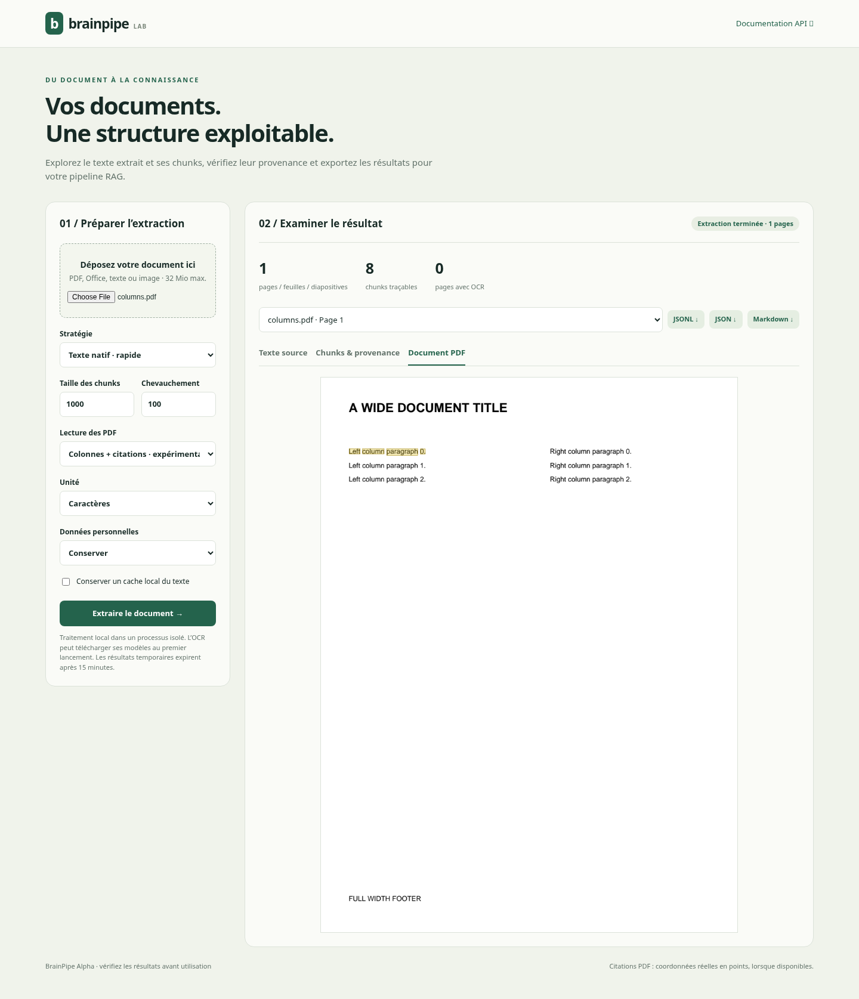

# BrainPipe

**Document ingestion for RAG, with inspectable output and isolated parser workers.**

BrainPipe combines a Rust extraction engine with a Python pipeline that supervises
each document in a separate process. Extract text, preserve Markdown structures,
create traceable chunks and export JSON, JSONL or Markdown.

**Alpha:** native-text and safety regressions are tested; OCR accuracy, complex
PDF tables and document layout still need broader evaluation. See the
[format matrix](docs/FORMATS.md) for precise limits. No universal speedup is claimed.

## Install

Requires Python 3.10–3.13 and stable Rust when building from source:

```sh
git clone https://github.com/Gogo27Gallet/brainpipe.git
cd brainpipe
python -m venv .venv
. .venv/bin/activate
pip install 'maturin>=1.10,<2'
maturin develop --release --extras cli,api,tokens
```

Windows activation: `.venv\Scripts\activate`. PDFium is installed automatically
through the pinned `pypdfium2` binary distribution; the runtime locates its shared
library without initializing a second engine. No separate native-library download
is needed, and basic PDF/text extraction works offline. For a custom deployment,
`BRAINPIPE_PDFIUM_PATH` explicitly overrides the packaged library.

Published wheels can be built by the CI workflow; release availability is not
implied by this source installation example. See [release gates](docs/RELEASING.md).

| Extra | Purpose |
|---|---|
| `cli` | Typer CLI, progress UI, legacy PDF inspection |
| `api` | FastAPI, multipart uploads, Uvicorn |
| `tokens` | Exact `cl100k_base` token budgets; vocabulary bundled for offline use |
| `langchain` / `llamaindex` | Independent framework adapters |
| `dev` | Regression tests, lint, synthetic fixture generation |
| `benchmark` | RSS measurements and optional PyMuPDF comparisons |

## Isolated Python pipeline

Use this mode for untrusted inputs or workloads needing timeouts and cancellation.
Save the following as a script; the `__main__` guard is required by spawned workers.

```python
from brainpipe import IngestConfig, ingest_isolated
from brainpipe.export import iter_export


def main():
    config = IngestConfig(
        workers=2,
        timeout_seconds=60,
        memory_mb=2048,
        max_pages=500,
        chunk_size=400,
        chunk_overlap=40,
        chunk_unit="tokens",  # install the tokens extra
        pii_mode="off",
    )
    with ingest_isolated("./documents", config) as pages:
        with open("results.jsonl", "w", encoding="utf-8") as target:
            for part in iter_export(pages, "jsonl"):
                target.write(part)


if __name__ == "__main__":
    main()
```

`PageResult` includes `source`, a SHA-256 `source_id`, `page_index`, content,
quality metadata, warnings and a typed error. A chunk carries a stable `id`, its
section, structure kind and exact `[start_char, end_char)` span in `page.content`.
These are Unicode character offsets. Native PDFs can additionally provide real
page coordinates, text blocks and word spans with `pdf_layout="reading_order"`:

```python
config = IngestConfig(pdf_layout="reading_order")
```

This opt-in mode groups geometric lines/paragraphs and uses XY-cut reading order.
`bbox` and `regions` use display-oriented PDF points with a top-left origin,
including page rotation and cropping. OCR/model/repair paths currently report
geometry as unavailable rather than inventing it. See [output schema](docs/OUTPUT.md).

Tables expressed in Markdown and fenced code blocks remain intact. A block
larger than the requested chunk budget is emitted with `oversized=True` and a
warning. Paragraphs are split with configurable overlap. This preserves content
without pretending all structured blocks fit every embedding model's budget.

Use the stream as a context manager. `cancel()` can be called from another
thread; `close()` releases workers when stopping early. File completion order
may vary; use `source` and `page_index` when assembling documents.

## CLI

```sh
brainpipe doctor --json
brainpipe doctor ./documents
brainpipe ingest-safe ./documents --format jsonl -o results.jsonl
brainpipe ingest-safe ./documents --pdf-layout reading_order -o cited.jsonl
brainpipe ingest-safe ./documents --unit tokens --chunk-size 400 --overlap 40
brainpipe ingest-safe ./documents --workers 2 --timeout 30 --memory-mb 2048
brainpipe serve --host 127.0.0.1 --port 8000
```

`ingest-safe` exits with code 2 if extraction errors are present and 130 after an
interrupt. JSONL can contain successful pages followed by a file-level error;
inspect errors rather than assuming an existing output file means full success.
The legacy `ingest`, `bench` and `compare` CLI commands remain available.

## Local document explorer and HTTP API

Open **[http://127.0.0.1:8000/demo](http://127.0.0.1:8000/demo)** after starting the
server. Upload a document, inspect pages and chunks, highlight a chunk's exact
source span, or click a located chunk to highlight its word regions on the original
PDF. Cancel the job and download results. The UI uses no external scripts.



| Endpoint | Behavior |
|---|---|
| `GET /health` | Service liveness; does not claim every parser/model is ready |
| `GET /diagnostics` | Disposable native probe, model presence and tool checks |
| `POST /ingest` | Synchronous extraction with the legacy response shape and `chunk_details` |
| `POST /jobs` | Submit a document; returns 202 and a job ID |
| `GET /jobs/{id}` | Status, page/error counts and cancellation state |
| `DELETE /jobs/{id}` | Request cancellation |
| `GET /jobs/{id}/results?format=jsonl` | Stream JSONL, JSON or Markdown results |
| `GET /jobs/{id}/pages/{page}/preview` | Resource-limited PNG source preview |

The local store runs up to two jobs with eight admitted active/queued jobs.
Results and preview-enabled PDF sources expire after 15 minutes and are lost on restart.
Previews are disabled for PII sanitization modes; changed/redacted pages drop stale geometry. Run **one Uvicorn
server process**; a shared durable queue is required before scaling API replicas.
Jobs may finish with partial results and status `failed` or `cancelled`.

There is no built-in authentication. Bind to localhost for personal use. See
[SECURITY.md](SECURITY.md) before exposing the service.

## OCR, models and cache

`strategy="auto"` loads OCR models for PDFs/images and makes the OCR decision
per page, so mixed native/scanned PDFs are considered. First use downloads RTen
OCR models. `strategy="ocr"` enables the OCR recovery path; it does not promise
that every already-readable page is rasterized. OCR language and quality support
must be evaluated on your corpus.

Embeddings/table detection require ONNX Runtime API 24 (1.24+) and compatible
models. Set `ORT_DYLIB_PATH` to the shared library. The base build does not
download CUDA binaries. The optional MuPDF backend requires an explicit Cargo
feature and separate licensing/build review:

```sh
maturin develop --release --features mupdf
```

The isolated pipeline defaults to **no persistent text cache**. Set `cache_dir`
explicitly to enable its versioned content/configuration cache. It hashes a
private file snapshot and never uses path/mtime alone as identity. The native
compatibility API defaults to sled caching in `.brainpipe_cache`; set
`use_cache=False` for sensitive inputs.

## Native compatibility API and integrations

For trusted inputs, the original Rust-backed API remains available:

```python
from brainpipe import ingest, ingest_text, build_ingest_report

pages = list(ingest("./documents", use_cache=False, chunk_size=1000))
texts = ingest_text("./documents")
report = build_ingest_report(pages)
```

It runs in the calling process and does not provide the isolated mode's hard
worker deadlines/resource supervision. Native streams use a 16-page bounded
channel and expose `close()`.

```python
from brainpipe.integrations.langchain import PyPDFLoader
from brainpipe.integrations.llamaindex import SimpleDirectoryReader
```

These adapters use the native API and require their respective extras. They
preserve multi-page metadata; LlamaIndex IDs include the page index. A local,
provider-independent retrieval example is in [examples/retrieve.py](examples/retrieve.py).

## Validation and performance

```sh
maturin develop --extras dev,api,cli,langchain,tokens
pytest -q
ruff check brainpipe tools
python tools/evaluate.py --output evaluation.json
python tools/evaluate_layout.py --output layout-evaluation.json
python tools/fuzz_documents.py --seed 1729 --rounds 40
python tools/benchmark.py ./pdf-corpus --mode native --runs 3 --build-label release
```

[Recorded evidence](docs/evidence/README.md) covers a small synthetic corpus,
mutation smoke tests and explicitly labeled performance runs. The benchmark
records first-page latency, throughput, errors, content hashes and sampled
process-tree RSS. Compare equivalent text outputs before comparing speeds;
isolated mode also pays for worker startup, safety checks and chunking.

## Contributing and licensing

See [CONTRIBUTING.md](CONTRIBUTING.md), [architecture](docs/ARCHITECTURE.md),
[changelog](CHANGELOG.md) and [release gates](docs/RELEASING.md).
The inherited [LICENSE](LICENSE) attributes the PDFium binary distributor.
The maintainer must confirm BrainPipe's own licensing before publishing a new
distribution; this work does not silently relicense existing contributions.
Tokenizer attribution and its bundled asset are described in
[THIRD_PARTY_NOTICES.md](THIRD_PARTY_NOTICES.md).
